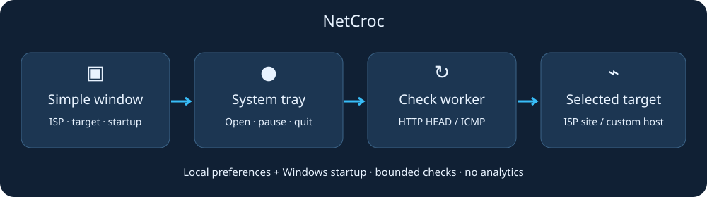

<p align="center"></p>

# NetCroc — Your quiet network companion.

A desktop network monitor with live speeds, usage history, saved Wi-Fi and optional connection tools.

[Download the latest release](https://github.com/4Raisan/NetCroc/releases/latest) · [Setup guide](#getting-started) · [Technical structure](docs/STRUCTURE.md) · [MIT license](LICENSE)

## Getting started

Choose **Setup** to install or **Portable** to run without installation. Download the matching file from the [latest release](https://github.com/4Raisan/NetCroc/releases/latest). Python is included.

| Platform | Install | Run without installing |
|---|---|---|
| Windows 64-bit | `windows-x64-Setup.exe` | `windows-x64-Portable.exe` |
| Linux 64-bit | `linux-x64-Setup.sh` | `linux-x64-Portable.sh` |
| Mac Apple Silicon | `macos-arm64-Setup.command` | `macos-arm64-Portable.command` |
| Mac Intel | `macos-x64-Setup.command` | `macos-x64-Portable.command` |

Every filename begins with `NetCroc-v<version>-`. Double-click Windows EXEs. On Linux/macOS, run `bash <downloaded-file>` in a terminal. The scripts contain the native application.

Windows Setup adds shortcuts and an uninstaller. Linux Setup installs to `~/.local/bin/NetCroc`; Mac Setup installs to `~/Applications/NetCroc.app`. Mac builds are not notarized; see [platform support](#platform-support-and-limits).

NetCroc starts monitoring when opened. Use **Check setup** for optional VPN tools.

On packaged Windows x64 builds with the updater, click **Update now** when a newer stable release is available. NetCroc verifies the download, applies it after closing and reopens. For older builds, macOS and Linux, download the matching file from Releases.

| What you want | Where to go |
|---|---|
| Current download/upload speed | Home or Live traffic |
| App/network usage over time | Usage: Last 30 days, This month or Last month |
| Saved Wi-Fi names/passwords | Wi-Fi; requires OS permission and a Wi-Fi service |
| Find missing components | Check setup |
| Use a WireGuard VPN | VPN → Install/update WireGuard → get/import a provider `.conf` → Connect |
| Use SSH/TLS or VLESS | Open its page, install required tools if shown, add your server account/profile |

### Why are extra tools needed?

- **WireGuard** creates the encrypted VPN adapter and connection. **Proton or another provider** supplies the account, server and `.conf` profile. NetCroc manages installation/updates of the official signed client on Windows.
- **Routing core (sing-box)** powers VLESS and whole-PC SSH routing. SSH local-proxy mode works without the routing core. The relevant page shows whether setup is needed.
- Administrator approval is required for system VPN/DNS changes. Installing tools does not automatically connect a VPN.

## What NetCroc records

Speeds are **bytes per second** (KB/s, MB/s, GB/s), not bits. Usage history is kept for 62 days while the app runs. Earlier missing history cannot be recovered. Per-app tracking needs Windows capture permission; adapter totals can include local-network traffic. VPN traffic can be attributed to the tunnel application.

Saved passwords display only where the OS permits access. Passwords are not written to usage history. Windows Sandbox generally exposes a virtual Ethernet adapter, so unavailable Wi-Fi is an expected limitation there.

## Optional connection tools

- Connection checks can help investigate idle stalls; they do not guarantee faster internet.
- DNS testing compares lookup times. Applying DNS is explicit, with saved settings and recovery protection.
- WireGuard, SSH/TLS and VLESS use your own provider profiles/accounts. NetCroc supplies no VPN service or free ISP data.
- Tray overlays support left, right, top and floating placement. Edge overlays stay open near their header controls; floating overlays stay where placed.

## Platform support and limits

| Area | Windows | Linux | macOS |
|---|---|---|---|
| Monitoring and desktop GUI | Locally tested | Automated tests/headless GUI where available | CI coverage; native hardware review pending |
| WireGuard setup | Signed official MSI managed in NetCroc | Install `wireguard-tools` through your package manager | Install `wireguard-tools` through Homebrew |
| Saved Wi-Fi | Requires WLAN service/hardware and OS permission | Requires NetworkManager/tool availability | Requires system Wi-Fi tools and authorization |
| Whole-PC tunnel operations | Requires administrator approval | Requires root authorization; isolated lab checks are separate | Requires native validation; experimental |

macOS builds are not Developer ID signed/notarized. Windows/Linux checks do not establish that every feature works on macOS. Provider connectivity and ISP billing must be tested on the actual network.

## Source setup

Requires **Python 3.12–3.14**, Tk and a graphical desktop.

- Windows: run `NetCroc-Setup.bat`.
- Linux: `bash NetCroc-Setup.sh`.
- macOS: `bash NetCroc-Setup.command` (or make the command executable and open it).
- Check Unix prerequisites without installation: `bash NetCroc-Setup.sh --check`.

Ubuntu/Debian prerequisites: `sudo apt install python3-venv python3-tk`. macOS with Homebrew: `brew install python@3.13 python-tk@3.13`; use `NETCROC_PYTHON=python3.13 bash NetCroc-Setup.sh`.

## Architecture



The GUI runs separately from background network tasks. Usage is stored locally in SQLite; provider credentials use platform encryption/key storage. Optional tools call operating-system services with explicit authorization.

## Development and releases

```text
python -m unittest discover -s tests
python tools/release.py --check
python tools/release.py --build
python tools/package_release.py
```

`tools/package_release.py` builds and verifies the application on the host OS. Windows packaging requires Inno Setup 6 and produces Setup and Portable EXEs. Linux/macOS packaging produces standalone Setup and Portable scripts. GitHub Actions provides native runners for each platform. Build dependencies include PyInstaller 6.22.3.

Generated downloads belong in the ignored local `releases/` folder. `NetCroc.bat` launches the current versioned Windows Portable EXE.

Source and release history are distinct: older published release tags may refer to an earlier source snapshot, as disclosed in those release notes. Generated evidence and archived experiments stay in ignored `test-artifacts/` and `Deep-Shit/` folders.

[Release notes](docs/RELEASE-NOTES.md) · [UI design decisions](docs/UI-DESIGN.md)

## License

NetCroc is licensed under the [MIT License](LICENSE). Third-party libraries and optional tools retain their own licenses.
