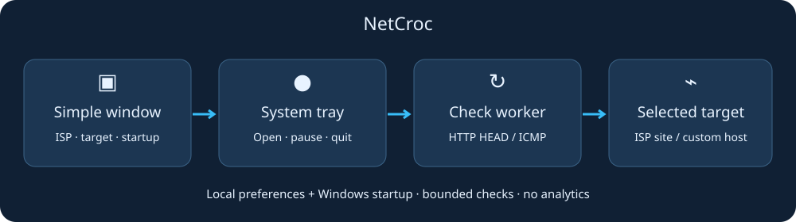

# Historical Fastlane notes

Archived reference only. Use the root README for current NetCroc paths and commands. These notes describe earlier builds.

## Optional smart mode and keep-alive comparison — 25 October 2026

Use `releases/Fastlane-updated.exe`. Quit any running Fastlane from its tray before opening this build.

- **Compare OFF / ON…** opens a six-minute comparison. Both phases measure the selected target every 10 seconds for three minutes; ON adds normal keep-alive checks at the selected interval. Smart mode is suspended during the test. Results show median response, p95 response and failed checks. Cancel is supported; the prior regular mode resumes after completion or cancellation if it was running. Settings are restored to their pre-test selection before resuming.
- **Optional smart mode** is OFF by default. With fresh selected-adapter traffic of at least 32 KB/s, checks use at least a 15-second interval. Quiet traffic returns to the chosen interval. Missing or stale samples preserve the chosen interval. Error backoff still applies. Adapter activity includes local traffic and can differ from application internet traffic.
- Comparisons are sequential observations, not proof of causation or a bandwidth/game-ping test. Sparse OFF probes can themselves keep a mobile radio warm and hide idle-only benefits. Repeat under similar conditions. HTTP response time includes the endpoint's work and setup overhead; ICMP timing is the total probe command duration. Refused/overloaded HTTP endpoints stop the comparison.
- Comparison sends probes only when explicitly started. No automatic DNS, Wi-Fi or VPN changes.

# Fastlane

The new application is **`releases/Fastlane.exe`**. The older Connection Tray EXE is preserved separately. This is a local Windows preview; administrator-only integration checks remain outstanding.

**25 October update:** use **`releases/Fastlane-updated.exe`** for the new three-period usage history. The currently running `Fastlane.exe` was left alone to avoid interrupting monitoring. Quit that copy from its tray menu before opening the updated build; both use the same settings/history location.

| Tab | Function |
|---|---|
| Keep-alive | Dialog, SLT, Mobitel, Airtel and Hutch HEAD targets; 1/5/10/15/30-second repeat delays; failure backoff |
| Live traffic | Download/upload in byte-based KB/s, MB/s and GB/s; speed graph; administrator-only per-app Internet TCP/UDP events |
| Usage history | Last 30 days, Last month, This month; network/app/daily totals, Wi-Fi filter, bar chart and CSV export |
| DNS | Repeated resolver benchmarks; explicitly confirmed IPv4 changes with saved original settings and an independent rollback watchdog |
| Saved Wi-Fi | Saved profiles and locally readable passwords; confirmed connect/forget controls |
| URL study | Repeat provider HEAD tests and select a candidate; no automatic network changes |

Speeds are **KB/s below 2 MB/s, MB/s from 2 MB/s, and GB/s at 1024 MB/s**. Units are 1024-based bytes, never bits. The 1-second keep-alive setting waits one second **after completion**; requests never overlap. The new default is one second, with existing saved preferences preserved. Failed checks back off; HTTP 403/405/429 waits at least 60 seconds. No guaranteed speed increase, free data, VPN or package bypass is included.

Run normally for live adapter totals, history, DNS tests and permitted Wi-Fi reads. Run as administrator locally for per-app ETW capture and DNS changes. The app never raises UAC or changes DNS/Wi-Fi automatically. Saved passwords display locally but are never written to history. Windows policies or location permissions can limit profile/connection access. Forget is blocked for the connected profile or when connection state cannot be verified.

History starts when monitoring starts and retains **62 local calendar days**, covering the previous and current month even when both have 31 days. The three choices apply to every network, application, graph and CSV export:

- **Last 30 days:** now back 30 days, using one-minute buckets rather than assuming midnight. The first/last minute has minute-level precision; recent data flushes about every five seconds.
- **Last month:** the full previous calendar month, ending just before the first instant of this month.
- **This month:** the first instant of this month through now.

The selected period refreshes while its tab is visible, including after midnight/month rollover. Existing daily-only records are preserved once during migration. They count where the whole known day is in the selected window; a partially overlapping old day with unknown timing is excluded and explicitly labelled. No timing or deleted history is invented.

It cannot reconstruct earlier days or usage while closed/asleep. Settings, `usage.sqlite3`, research results and DNS restore state live in `%LOCALAPPDATA%\ConnectionTrayPreview`. History records dates, adapter/Wi-Fi names, executable paths and byte totals, not packet payloads, website browsing history or Wi-Fi passwords. Select a specific network to avoid counting virtual/physical adapter copies twice. Adapter totals include LAN/overhead; per-app figures exclude non-global remote addresses. VPN/proxy traffic may be attributed to the tunnel application. Neither measurement is an ISP billing counter. Wi-Fi transitions are sampled about every five seconds; boundary bytes may fall on the adjacent profile.

DNS testing changes no settings. Applying requires administrator access and a confirmation, preflights the resolver, saves DHCP/static configuration and starts a rollback watchdog before mutation. IPv6 is unchanged. A brief DNS interruption remains possible: leave DNS unchanged while remote. Restore original DNS is available; a pending failed/crashed transaction can also be restored. Browsers and VPNs may override system DNS. Committed DNS changes remain after quitting.

Source setup and tests:

```powershell
python -m pip install -r src/requirements.txt
python src/app.py
python -m unittest discover -s src/tests -v
python src/release.py --build
```

Building requires `PyInstaller==6.22.3`; the standalone EXE bundles Python and dependencies. Python 3.12–3.14/Tcl-Tk is needed only for source execution. The target is Windows 10/11 x64; validation here uses Windows 11. The new psutil dependency uses BSD-3-Clause. Existing license notes below still apply.

See [STUDY-AND-TESTS.md](STUDY-AND-TESTS.md) for measured results and validation limits. Previews in `test-artifacts/previews/` use explicitly synthetic, password-free data. `--diagnostics OUTPUT.json` constructs the frozen UI without starting monitoring or changing networking.

## Legacy Connection Tray reference

The remaining instructions describe the preserved older `Connection-Tray.exe`, rather than the new Fastlane dashboard.


Quiet Windows connection checks for **Dialog, Mobitel, Hutch and Airtel**. Name and icon are provisional until the preview is checked.

## Use

Open `releases/Connection-Tray.exe`, choose an ISP, optionally tick **Run automatically when I sign in**, then **Save & Start**.

- Leave the custom target blank to use the ISP website, or enter your own website/IP.
- Choose HTTP HEAD (default) or ICMP, with 5/10/15/30 second intervals.
- Tick **Show connection checks** if wanted. Pause before changing settings, then Save & Start.
- Closing hides the window; the tray menu opens it, pauses checks or quits. Opening the EXE again shows the existing window.

Windows controls whether the icon appears beside the clock or under **Show hidden icons**.

## Startup and behavior

Untick startup and Save & Start to remove it. Only this app's `ConnectionTrayPreview` value in your account's Windows Run key is changed. Keep the EXE at the same path; after moving it, save startup again. Startup starts saved checks hidden; Quit does not disable the next sign-in launch.

Preset targets: dialog.lk, www.mobitel.lk, hutch.lk and www.airtel.lk. The original selfcare.hutch.lk can be entered manually. ISP selection selects a target; it does not change your network. Checks create small requests, without any guarantee of higher speed or fewer disconnections.

HTTP errors also count as a server response. ICMP can be blocked while browsing works. Milliseconds show total check duration. Failures retry after the interval. Each check times out after four seconds.

Preferences are stored in `%LOCALAPPDATA%\ConnectionTrayPreview\settings.json`; avoid URLs with secrets. The most recent 100 checks stay in memory only. No analytics or credentials are collected. HTTP may follow redirects.

## Source and releases

Windows and Python 3.12-3.14:

```powershell
python -m pip install -r src/requirements.txt
python src/app.py
python -m unittest discover -s src/tests
```

For the unsigned EXE, install `PyInstaller==6.22.3` and run `python src/release.py --build`.



`src/app.py` launches; `src/` separates window/tray from checks/settings; `src/assets/` holds preview artwork/diagram; `src/tests/` verifies behavior; `src/release.py` builds/checks. Commit these with README, requirements and .gitignore. Local `releases/` is ignored; attach runnable release files to a GitHub Release later.

**Status:** local and unpublished. Real-world trials on each ISP, final branding and repository URL are pending. GitHub opens the author's profile. Historical Hutch files/artwork are backed up outside this folder.

No source license is selected. Pillow uses HPND, pystray LGPL-3.0, and PyInstaller GPL-2.0-or-later with a bootloader exception; review dependency distribution obligations before publication. Independently inspired by [Z Pinger](https://play.google.com/store/apps/details?id=com.zentix.zpinger); no ISP or Z Pinger affiliation.

## Requirements and error recovery

**EXE users:** Python and required Python packages are bundled inside the release. You do not need to install Python, pip or requirements.txt. Use Windows 10/11 64-bit; the current EXE was built on Windows 11 with Python 3.14.3. Older Windows versions and 32-bit systems are unsupported by this release.

**Source users:** Install Windows Python 3.12-3.14 with pip and Tcl/Tk, then run python -m pip install -r src/requirements.txt. There are no additional setup BATs; installation errors stay visible in your terminal. Python is installed separately. Python itself cannot be installed through a pip requirements file.

Startup/import errors and unexpected GUI callback errors display the problem and a fix. A minimal startup-error.log is saved under your app's LocalAppData folder; it records exception type and code locations without passwords, email values or full exception messages.

If Windows prevents the EXE from opening before the app starts, its error handler cannot run. Check Windows Security protection history, available disk space and access to your TEMP folder, then obtain a fresh complete release if damaged. Do not disable Windows security. Missing-component errors in an EXE require a fresh build/download, not a separate Python installation.

## Minimal layout

Only README.md and .gitignore remain at the root. src/ contains all editable code, required artwork, dependencies and the release helper. releases/ contains ready-to-use files. There are no setup/fixer BATs. Bandi and WinRAR retain their actual batch program inside src/.


## BAT release

Run releases/Connection-Tray.bat to launch the bundled EXE. Keep the BAT and EXE together. The BAT reports a missing EXE or unsuccessful exit and keeps the error visible. Python is bundled; the BAT does not install it. Editable implementation remains in src/.
